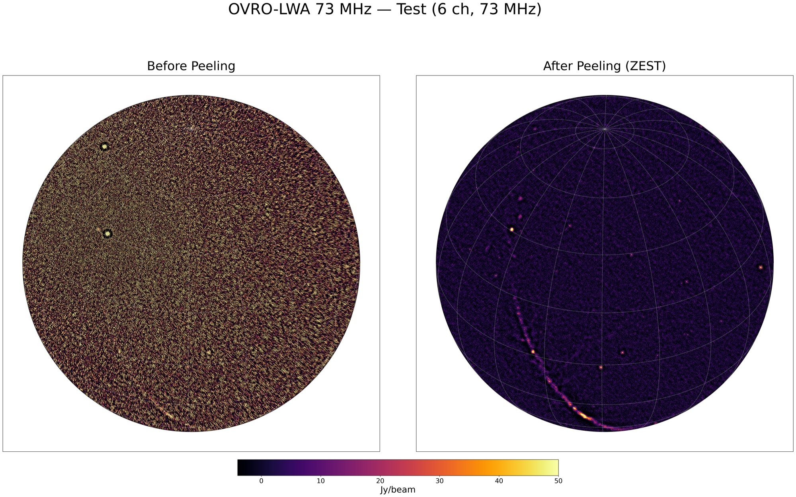
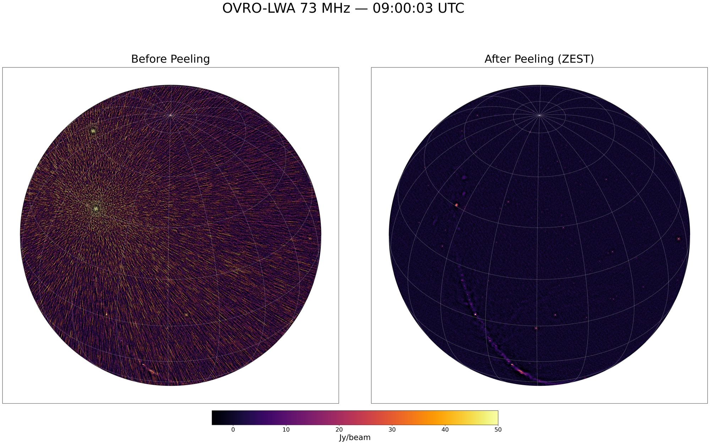
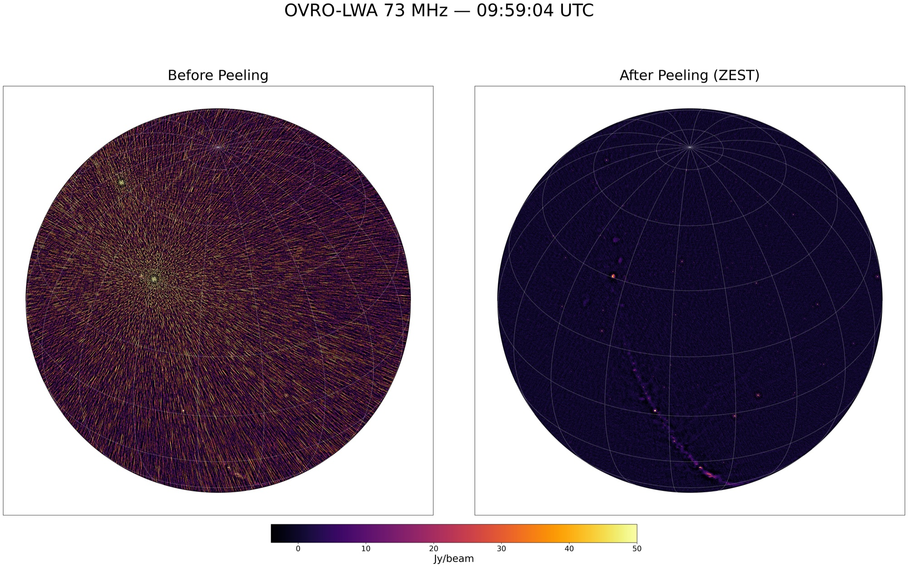

# [Tutorial](@id tutorial)

Peel the bright sources from OVRO-LWA snapshots with `bin/zest_sky_rfi.jl`, then image them.
Paths in `<angle brackets>` are placeholders for your own data.

## Environment (calim servers)

```bash
conda activate /opt/devel/pipeline/envs/py38_orca_nkosogor
export PATH="/opt/devel/nkosogor/nkosogor/julia-1.10.4/bin:$PATH"
export JULIA_DEPOT_PATH="/tmp/julia_${USER}:/opt/devel/nkosogor/nkosogor/julia_depot"
T=/opt/devel/nkosogor/nkosogor/TTCalX        # or your clone of TTCalX (see Installation)
zest() { julia --project=$T $T/bin/zest_sky_rfi.jl "$@"; }
```

The shared install is the version the production pipeline runs (tag `gsi-v2`); see
[Installation](install.md) to run `main` (0.3.0) with the same environment.

## 1. Quick test (example MS)

`examples/20240524_090003_73MHz_ch0to5.ms` (6 channels at 73 MHz, ~22 MB, already calibrated,
data in `DATA`). Always work on a copy.

```bash
mkdir -p <work dir> && cd <work dir>
cp -r $T/examples/20240524_090003_73MHz_ch0to5.ms test.ms
zest --column=DATA --rfi=$T/sources/rfi_43.2_ver20251101.json $T/sources/sources_7src_tauA.json test.ms
```

These are the production settings: the defaults of `zest_sky_rfi.jl` (RK4 StefCal, `maxiter=5`,
`tolerance=1e-4`, `minuvw=5`, `peeliter=3`, `max-gain=100`, exact model, geometric UVW, residual
guard) plus the RFI emitters peeled after the sky (`--rfi-mode=after`). The sky model has Cyg A,
Cas A, Tau A, Vir A, Her A, Hya A and Per B. `--help` lists the other options; see
[CLI Reference](cli.md).

## 2. Full snapshots: calibrate, peel, image

```bash
cp -r <night-time averaged MS dir>/20240524_*_73MHz_averaged.ms .
python3 - <<'EOF'
import glob
from casatasks import applycal
for ms in sorted(glob.glob("20240524_*_73MHz_averaged.ms")):
    applycal(vis=ms, gaintable=["<delay table>", "<bandpass table>"], calwt=[False], flagbackup=True)
EOF
```

`applycal` writes `CORRECTED_DATA`, the default column of both CLIs. Peel all MSes in one call,
so that only the first one pays the ~1 min of Julia compilation:

```bash
zest --rfi=$T/sources/rfi_43.2_ver20251101.json $T/sources/sources_7src_tauA.json 20240524_*_73MHz_averaged.ms
```

Opt-in options for consecutive snapshots of one band: `--precision=mixed --warm-start`
(single-precision normal equations; start from the previous snapshot's gains).

**Alternative, `bin/ttcal_gpu.jl`** (damped StefCal, kernel model, MS UVW; modes peel, zest, shave,
prune; defaults `maxiter=30`, `minuvw=10`):

```bash
julia --project=$T $T/bin/ttcal_gpu.jl zest $T/sources/sources_7src_tauA.json 20240524_*_73MHz_averaged.ms
```

### Image with the GPU imager

`ttcalx-image snapshot` makes the orca snapshot products (CLEAN I, dirty V, QA JSON) on one GPU.
It reads the `DATA` column, so peel into `DATA` (`--column=DATA`, as the pipeline does) or copy
the peeled column there first. Installation: [GPU CLEAN imager](gpu-clean-imager.md).

```bash
ttcalx-image snapshot 20240524_*_73MHz_averaged.ms --out-dir images/
#   -> images/<stem>-I-image.fits, <stem>-V-image.fits, <stem>-qa.json
```

### Alternative: WSClean through orca (dirty image)

```python
from pathlib import Path
from orca.wrapper.wsclean import wsclean

out_dir = Path("images").resolve(); out_dir.mkdir(exist_ok=True)
for ms in sorted(Path(".").glob("20240524_*_73MHz_averaged.ms")):
    wsclean(ms_list=[str(ms.resolve())], out_dir=str(out_dir),
            filename_prefix=ms.stem.replace("_averaged", "_zested"),
            extra_arg_list=["-pol", "IV", "-size", "4096", "4096", "-scale", "0.03125",
                            "-niter", "0", "-weight", "briggs", "0",
                            "-horizon-mask", "10deg", "-taper-inner-tukey", "30"],
            num_threads=4, mem_gb=50)
```

## Timing (February 2026)

`ttcal_gpu.jl zest`, version of 2026-02-06, on an RTX A4000 (16 GB); 73 MHz, 352 antennas,
48 channels. For the 0.3.0 `zest_sky_rfi.jl` timings see the [README](https://github.com/nkosogor/TTCalX#peeling).

| MS | time |
|---|---|
| first | ~27 s (includes compilation) |
| each further MS | ~5-10 s |

## Example results (February 2026)

Dirty Stokes I images (`niter=0`) before and after `ttcal_gpu.jl zest`, same setup as the timing.

Quick test (6 channels):



Full MSes (48 channels), 09:00:03, 09:30:09 and 09:59:04 UTC:




